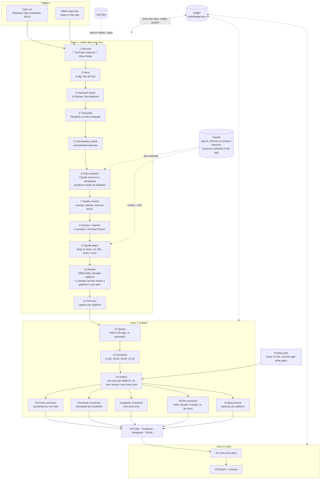

# How the clipper is put together

One run goes from "find this week's videos" to "clips waiting at their posting
times" with nobody editing anything. This page shows the stages in order, the
settings each one runs with, and how the design compares with the published
systems it was checked against.

## The system

Solid arrows are the order of work. Dotted arrows are outside services and the
ledger, the one file that remembers what has been fetched, made and posted so
nothing is done twice.

Stages 3, 5, 7 and 9 can each remove a video or a clip. Whatever they remove is
listed in the report with the reason.

## Settings of each stage

| # | Stage | What it does | Settings (file: `config.toml`, or Settings in the app) |
|---|---|---|---|
| | Daily run | Starts lane 1 by itself | Windows Task Scheduler task "Clipper daily run"; time set in the app (06:00 unless changed); runs while the computer is on and signed in |
| 1 | Discover | Lists videos uploaded this week and picks which to take | 7 searches (`[[sources]]`), 25 results looked at per search; title must say one of "no commentary", "no talking", "gameplay only", "raw gameplay" and none of "reaction", "reacts", "live", "stream", "podcast", "review", "trailer", "leak"; `min_views` 200-2,000; length 1-240 min; 1-2 videos per search; never from Rockstar Games or Take-Two; plus anything dropped into `inbox/` |
| 2 | Fetch | Downloads the chosen videos | yt-dlp; `max_hours = 0.5` (only the first half hour of a long video); a failed video is retried on up to 3 runs; if YouTube asks to confirm you are not a bot, the video is recorded as not fetched and nothing tries to get around it |
| 3 | Facecam check | Leaves out videos with a streamer's webcam | `[filters] no_facecam = true`; 16 frames; a face that stays in the same spot in 60% of them is a webcam |
| 4 | Transcribe | Every spoken word with its timing | Parakeet TDT 0.6b v2 with voice detection, on this computer's processor, 4 threads; nothing is sent anywhere |
| 5 | Commentary check | Leaves out someone talking over the game | `[filters] no_commentary = true`; phrases only a commentator says ("chat", "this game", "like and subscribe", ...); a short clip is out on 1 hit, a long video needs 3 hits of 2 kinds; in a long video only the stretches around the talk (30 s either side) are skipped, unless it runs throughout |
| 6 | Find moments (Claude scout) | Picks the stretches worth clipping | With Claude: it is shown the whole video as sheets of frames with their times (one frame every 5 to 20 seconds, up to `ai.max_frames = 100`), what is said, and where the sound stands out, and picks the moments, each with a title, a reason and a score (`[ai] scout = true`, `scout_effort = "medium"`). Without Claude, or if the request fails: every half second scored on loudness against the minutes around it, talking speed and the sections' cue words; clips of `min_len = 85` to `max_len = 95` seconds, at most 3 per video |
| 7 | Quality checks | Removes repeats and unsuitable clips | Overlap with a clip already made at most 30%; text similarity with another clip at most 0.6; banned terms (gambling sponsors, political terms) |
| 8 | Section + frames | Files each clip and prepares what the editor looks at | Sections: findings, tricks, glitches, moments (`[[sections]]`; Claude's choice when it picked the moment, cue words otherwise); sections take turns so a day's posts differ; 16 frames from 15 seconds before the clip to 15 seconds after it, each with its time |
| 9 | Claude editor | Decides keep or drop, moves the cut to where the action starts, and writes the title, headline, summary, search tags and up to three on-screen notes; picks the cover frame; scores the clip | `[ai] edit = true`, `model = "claude-opus-5-5"`, `effort = "low"`, `margin = 15` (seconds each end may move), `direction` (what the channel wants, in plain words). A finished clip can be edited again from the app with an instruction. It also marks graphic moments (the start is then moved so none falls in the first 15 seconds) and drops clips with another platform's watermark or with content no platform pays for (`[monetize]`) |
| 10 | Render | The finished vertical video | 1080x1920, 30 fps; `layout = "blur"` (whole picture over a blurred copy, zoom 1.5); karaoke captions 3 words at a time, the spoken word in yellow; headline for the first 3.5 s; section badge; credit to the source channel; progress bar; sound levelled to -14 LUFS. Then the cut each platform gets (`[edits]`, or Settings in the app): TikTok clips over a minute only, YouTube at most 59 s, Facebook at most 90 s, Instagram at most 180 s; where a clip is longer than a platform's maximum a second version is rendered around the moment the clip builds to, with its own captions and cover. Strong language is silenced in the sound; the cover is never a graphic moment |
| 11 | Post text + search check | Caption for each platform, then a check that it will be found | Every caption reads "title \| GTA 6 keyword" (the section's `keyword`: Secret, Tips, Glitch, Gameplay), then the credit and hashtags: the section's, #gta6, and a rotating pick, to 5 for TikTok, 8 for Instagram, 4 for Facebook; YouTube title ends in "#shorts", its description carries the summary, the credit and a link to the original, its tags start with the review's search tags; saved next to the clip as `<id>.txt`. The check covers lengths, hashtag counts, the game's name, the credit and banned terms; a clip that fails is not posted by itself. Then the monetization check per platform: opening, language, watermarks, music (heard by a sound-recognition model on this computer), a moving and sharp picture, hashtags, originality; a platform whose rule the clip breaks is not sent it |
| 12 | Queue | Where finished clips wait | `[publish] hold_for_review = true`: clips wait in the app until you post them. "Post automatically" in Settings puts them in the outbox without waiting |
| 13 | Schedule | Gives each clip a posting time | `[schedule] slots = ["11:30", "15:00", "19:00", "21:30"]`, `timezone = "America/New_York"`; one clip per slot; extra clips fill up to 3 days ahead |
| 14 | Outbox and connectors | Sends each clip to each platform at its time | One post per platform per clip. YouTube and Facebook get the clip at once with its time and publish it themselves; TikTok and Instagram are sent when the time comes (the app while open, or the Windows task "Clipper posting" every 15 minutes). Retries with a growing wait, up to 5 tries; never sent twice. Direct connectors: YouTube Data API, TikTok Content Posting API (`tiktok_direct = "draft"` or `"private"`), Meta Graph API for Facebook and Instagram. The posting service (Upload-Post) per platform via `prefer_service`. Each platform is handed its own version of the clip. TikTok: `publish.tiktok_direct` = draft, private or public (public only from an app TikTok has audited), with audience, comments, duets and stitches per clip; a clip posted by hand is marked in the app and not sent again |
| 15 | Links and views | Reads back whether each post is out, its link and its views | Asked from each platform every ten minutes while the app is open and by `python -m clipper post`; a post that failed shows why, with "Try again" |
| 16 | Report + cleanup | What was made, posted, left out and why | `reports/latest.md` and the Activity tab; downloads deleted after 2 days, clips after 30 |

"Check everything" in the app (`python -m clipper check`) tries stages 1, 2, 4,
10, 9 and 14 for real on the computer it runs on and reports each as working,
needing attention or not set up.

Where things are kept: the ledger in `state/ledger.json` (several processes use
it at once; saving merges record by record); settings changed in the app and
the connected accounts in `settings.json`; keys and sign-ins in Windows
Credential Manager; a sign-in with Claude in Anthropic's own folder
(`%APPDATA%\Anthropic`), written by its sign-in tool and read by its SDK; Claude's request count in `state/ai_usage.json`. On Windows
all of it is under `clipper-run\data`.

## Connections to outside services

| Service | Used for | Needed? | Cost |
|---|---|---|---|
| YouTube (as a video site) | Finding and downloading the videos | Yes; no account or key. Works from a home connection only | Free |
| Claude (signed in with a Console account, an API key, or Amazon Bedrock; several accounts can be saved and switched in the app) | Picking the moments, checking and editing each clip (stages 6 and 9) | Optional. Without it the loudness finder and rule-based titles are used and nothing looks at the picture | Pay as you go: about one request per video and one per clip |
| YouTube Data API | Posting to YouTube, with your own Google project | For direct posting to YouTube | Free; 100 uploads a day |
| Meta Graph API | Posting to Facebook and Instagram, with your own Meta app | For direct posting to those two | Free |
| TikTok Content Posting API | A draft in the TikTok inbox, a private post, or a public post once TikTok has audited the app, with your own TikTok app | For direct delivery to TikTok | Free |
| Upload-Post | Posting through a service whose apps the platforms approved | Optional; the way to public, hands-off TikTok posts | Free plan: 10 uploads a month, no TikTok. Basic: $24 a month |

What each platform lets a self-registered app do, and how to connect it, is in
[ACCOUNTS.md](ACCOUNTS.md).

Everything else (speech recognition, face detection, cutting, captions,
rendering) runs on this computer with no account.

## Published systems this was checked against

No published blueprint does this job as specified: gameplay-only footage,
clips of about 1:30, videos found by search, four platforms. The closest ones,
and what was taken from each:

| Published system | Its shape | Same here | Different here |
|---|---|---|---|
| n8n template 9867 (Whisper + Gemini + Upload-Post) | Upload a video, transcribe, one AI call picks the clips and writes the text, cut, schedule | Transcribe, cut, schedule through Upload-Post | It picks moments from the transcript alone, so it cannot handle gameplay with no talking; it has no vertical reframing, no captions and no Facebook as published. Here the moments come from the sound and the AI judges afterwards |
| n8n template 22146 (OpusClip + Airtable + Buffer) | Three lanes: a queue of videos, a collector of finished clips, a publisher that posts at set times | The three lanes and the status record that stops anything being sent twice | A clipping service does the cutting there and it posts to two platforms; here the cutting is local and the ledger file is the status record |
| OpenShorts "content machine" (n8n, 30 nodes) | Daily schedule, clip the newest video, approve each clip on Telegram, post in the next free slot, weekly numbers | Daily trigger, next-free-slot scheduling, approval before posting, view counts read back | Approval there is a person on Telegram; here it is the automatic review, with the app as the place to look if you want to |
| SupoClip and AutoClip (open source) | Web app, job queue, stages that save their work so a run can resume | Stages that save their work; a run that was interrupted is picked up again | Both pick moments with an AI reading the transcript and follow faces when cropping; neither filters for gameplay-only footage |
| Clipping services with an API (OpusClip, Vizard, Klap, Submagic) | Send a video link, get captioned clips back, some also post | Clips of about 90 s are possible in all four | They choose by what is said and by their own score, and cannot apply the gameplay-only rule; they cost $19-39 a month and up. Not used |

Two things appear in those systems and not yet here: a message to your phone
when clips are ready, and view counts feeding back into which kinds of clip are
made next.
