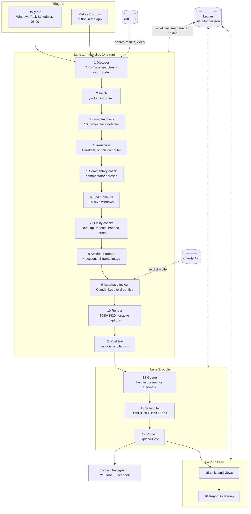

# How the clipper is put together

One run goes from "find this week's videos" to "clips waiting at their posting
times" with nobody editing anything. This page shows the stages in order, the
settings each one runs with, and how the design compares with the published
systems it was checked against.

## The system

Solid arrows are the order of work. Dotted arrows are outside services and the
ledger, the one file that remembers what has been fetched, made and posted so
nothing is done twice.

Stages 3, 5, 7 and 9 can each remove a video or a clip. Whatever they remove is
listed in the report with the reason.

## Settings of each stage

| # | Stage | What it does | Settings (file: `config.toml`, or Settings in the app) |
|---|---|---|---|
| | Daily run | Starts lane 1 by itself | Windows Task Scheduler task "Clipper daily run"; time set in the app (06:00 unless changed); runs while the computer is on and signed in |
| 1 | Discover | Lists videos uploaded this week and picks which to take | 7 searches (`[[sources]]`), 25 results looked at per search; title must say one of "no commentary", "no talking", "gameplay only", "raw gameplay" and none of "reaction", "reacts", "live", "stream", "podcast", "review", "trailer", "leak"; `min_views` 200-2,000; length 1-240 min; 1-2 videos per search; never from Rockstar Games or Take-Two; plus anything dropped into `inbox/` |
| 2 | Fetch | Downloads the chosen videos | yt-dlp; `max_hours = 0.5` (only the first half hour of a long video); a failed video is retried on up to 3 runs; if YouTube asks to confirm you are not a bot, the video is recorded as not fetched and nothing tries to get around it |
| 3 | Facecam check | Leaves out videos with a streamer's webcam | `[filters] no_facecam = true`; 16 frames; a face that stays in the same spot in 60% of them is a webcam |
| 4 | Transcribe | Every spoken word with its timing | Parakeet TDT 0.6b v2 with voice detection, on this computer's processor, 4 threads; nothing is sent anywhere |
| 5 | Commentary check | Leaves out someone talking over the game | `[filters] no_commentary = true`; phrases only a commentator says ("chat", "this game", "like and subscribe", ...); a short clip is out on 1 hit, a long video needs 3 hits of 2 kinds; in a long video only the stretches around the talk (30 s either side) are skipped, unless it runs throughout |
| 6 | Find moments | Picks the stretches worth clipping | Every half second scored on loudness against the minutes around it, talking speed, the sections' cue words, and chat speed when a chat log is there; works with no speech; `[moments] min_len = 85`, `max_len = 95`, `max_per_source = 3`; a video of 80-100 s is used whole |
| 7 | Quality checks | Removes repeats and unsuitable clips | Overlap with a clip already made at most 30%; text similarity with another clip at most 0.6; banned terms (gambling sponsors, political terms) |
| 8 | Section + frames | Files each clip and prepares what the review looks at | Sections: findings, tricks, glitches, moments (`[[sections]]`, by cue words in the title and speech); sections take turns in the posting order; one image of 8 frames per clip |
| 9 | Automatic review | Decides keep or drop, the section, the title, the headline and a one-line summary | `[review] model = "claude-opus-5-5"`, `effort = "low"`, `frames = 8`; answers in a fixed form; needs a Claude API key (Accounts in the app); with no key, or if a request fails, the clip keeps a rule-based title |
| 10 | Render | The finished vertical video | 1080x1920, 30 fps; `layout = "blur"` (whole picture over a blurred copy, zoom 1.5); karaoke captions 3 words at a time, the spoken word in yellow; headline for the first 3.5 s; section badge; credit to the source channel; progress bar; sound levelled to -14 LUFS |
| 11 | Post text | Caption for each platform | Title + credit + hashtags: 5 for TikTok, 8 for Instagram, 4 for Facebook; YouTube title ends in "#shorts" and its description carries the summary, the credit and a link to the original; saved next to the clip as `<id>.txt` |
| 12 | Queue | Where finished clips wait | `[publish] hold_for_review = true`: clips wait in the app until you post them. "Post automatically" in Settings sends them on without waiting |
| 13 | Schedule | Gives each clip a posting time | `[schedule] slots = ["11:30", "15:00", "19:00", "21:30"]`, `timezone = "America/New_York"`; one clip per slot; extra clips fill up to 3 days ahead |
| 14 | Publish | Sends the clip and its text to the four accounts | Upload-Post, one key for all four; `platforms = ["tiktok", "instagram", "youtube", "facebook"]`; `tiktok_post_mode = "DIRECT_POST"` (or `"MEDIA_UPLOAD"` to land in TikTok drafts); a dropped connection is retried without posting twice |
| 15 | Links and views | Collects each post's link and view count | `python -m clipper status`, also part of the daily run |
| 16 | Report + cleanup | What was made, posted, left out and why | `reports/latest.md` and the Activity tab; downloads deleted after 2 days, clips after 30 |

Where things are kept: the ledger in `state/ledger.json`; settings changed in the
app in `settings.json`; the two keys in Windows Credential Manager. On Windows
all of it is under `clipper-run\data`.

## Connections to outside services

| Service | Used for | Needed? | Cost |
|---|---|---|---|
| YouTube | Finding and downloading the videos | Yes; no account or key. Works from a home connection only | Free |
| Upload-Post | Posting to TikTok, Instagram, YouTube and Facebook | Yes, to post from the app. Without it the clips and their text are made and you upload by hand | Free plan: 10 uploads a month, no TikTok. Basic: $24 a month |
| Claude API | The automatic review (stage 9) | Optional. Without it titles are written by rule and nothing checks the clip's picture | Pay as you go; tens of cents a day at a dozen clips |

Everything else (speech recognition, face detection, cutting, captions,
rendering) runs on this computer with no account.

## Published systems this was checked against

No published blueprint does this job as specified: gameplay-only footage,
clips of about 1:30, videos found by search, four platforms. The closest ones,
and what was taken from each:

| Published system | Its shape | Same here | Different here |
|---|---|---|---|
| n8n template 9867 (Whisper + Gemini + Upload-Post) | Upload a video, transcribe, one AI call picks the clips and writes the text, cut, schedule | Transcribe, cut, schedule through Upload-Post | It picks moments from the transcript alone, so it cannot handle gameplay with no talking; it has no vertical reframing, no captions and no Facebook as published. Here the moments come from the sound and the AI judges afterwards |
| n8n template 22146 (OpusClip + Airtable + Buffer) | Three lanes: a queue of videos, a collector of finished clips, a publisher that posts at set times | The three lanes and the status record that stops anything being sent twice | A clipping service does the cutting there and it posts to two platforms; here the cutting is local and the ledger file is the status record |
| OpenShorts "content machine" (n8n, 30 nodes) | Daily schedule, clip the newest video, approve each clip on Telegram, post in the next free slot, weekly numbers | Daily trigger, next-free-slot scheduling, approval before posting, view counts read back | Approval there is a person on Telegram; here it is the automatic review, with the app as the place to look if you want to |
| SupoClip and AutoClip (open source) | Web app, job queue, stages that save their work so a run can resume | Stages that save their work; a run that was interrupted is picked up again | Both pick moments with an AI reading the transcript and follow faces when cropping; neither filters for gameplay-only footage |
| Clipping services with an API (OpusClip, Vizard, Klap, Submagic) | Send a video link, get captioned clips back, some also post | Clips of about 90 s are possible in all four | They choose by what is said and by their own score, and cannot apply the gameplay-only rule; they cost $19-39 a month and up. Not used |

Two things appear in those systems and not yet here: a message to your phone
when clips are ready, and view counts feeding back into which kinds of clip are
made next.
